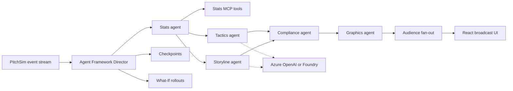

<p align="center"></p>

# Playmakers

Playmakers is a multi-agent TV production crew for football. It reads a live match event stream, works out what matters, explains it with cited evidence, renders timed broadcast overlays, and tailors the output for each viewer. Built for the Microsoft x Premier League "Inside the Game" hackathon.

## What to look at

- **Multi-agent Director.** A Microsoft Agent Framework workflow runs a Stats agent, then Tactics and Storyline agents in parallel. A Compliance agent checks every metric, cited event ID and number in the prose against the deterministic Stats results before Graphics publishes a cue. Models are called only on key moments (shots, goals, fouls, cards, substitutions, kickoff and period changes, plus every 30th event as a tactical beat). Routine events get a rule-written caption built from the verified stats, which Compliance checks the same way, and the Why? panel says no model was called. A mock match makes 214 model calls (seed 7), down from 3,148 when every event called both agents.
- **Kill and recover.** Press "Stop Tactics agent" mid-match. A template cue covers the gap, the agent restarts from a checkpoint, replays missed events and catches up. Every step shows in the agent trace.
- **What-If Lab.** Goals, big chances and red cards trigger 200 seeded match simulations comparing before, after and the counterfactual ("if the shot had been saved"). The card sets the actual win chance against the alternative as two bars with the swing in points, and the events behind it are ringed on the pitch for two match minutes.
- **"Why did it say that?"** Every caption has a Why? link. It opens the agent that wrote it, the Compliance verdict (verified, corrected after a rejection, or replaced by a template, with the reason), the supporting events (click one to ring it on the pitch) and the stats it used. What-If cards say plainly that they come from simulations, not Compliance review.
- **Full-time recap.** At the final whistle the Storyline agent writes a recap from the verified score. Compliance checks it and every language variant like any other cue. The recap lists 4–6 key moments (goals and red cards first, then the biggest chances) with timestamps and event IDs, and has Copy and Share-as-text buttons. Works offline with the mock models.
- **Voice commentary.** A Voice toggle reads the fan line aloud in English, Spanish or French using the browser's speech engine. To avoid talking over the match it speaks only priority moments (goals, red cards, What-If, the recap), at least 8 seconds apart. An optional Azure AI Speech voice is available behind environment variables (see [Live models](#live-models)). It has not yet been tested against a live Azure resource.
- **Personalization.** Analyst and fan feeds side by side from one shared match run, in English, Spanish or French, with favourite-player emphasis.
- **Stats MCP server.** Deterministic metrics (xG, pressure, pass difficulty, momentum) exposed as MCP tools, each result citing event IDs.

## Architecture



## Hackathon pipeline

| Stage | Where |
| --- | --- |
| Ingest | PitchSim replay over SSE or WebSocket, typed `MatchEvent` schema |
| Interpret | Stats engine and MCP tools, What-If simulations |
| Explain | Tactics and Storyline agents, verified by Compliance |
| Render | Graphics validates each cue against the `OverlayCue` schema (duration, priority, layer, broadcast-safe area); React canvas overlays |
| Personalize | Audience fan-out by persona, language and favourites |

## Quickstart

Needs Python 3.12+ and Node 20.19+. Runs fully offline with mock models; no credentials.

```bash
python3 -m venv .venv && source .venv/bin/activate
pip install -r requirements-dev.txt
for p in packages/playmakers_schema packages/pitchsim packages/playmakers_stats \
         services/stats_mcp packages/playmakers_agents services/replay_api; do pip install -e "$p"; done

uvicorn replay_api.main:app --port 8000      # terminal 1
cd web && npm ci && npm run dev              # terminal 2
```

Open http://localhost:5173. Or run everything with `docker compose up --build`.

Command-line demo with an injected failure:

```bash
python -m playmakers_agents demo --seed 7 --speed 50 --persona analyst --kill tactics@20
```

## Tests

```bash
pytest
cd web && npm test
scripts/verify.sh   # boots API + web, runs the Playwright journey, saves screenshots
                    # (first run: cd web && npx playwright install chromium)
```

## Live models

Set `AZURE_OPENAI_ENDPOINT` and `AZURE_OPENAI_DEPLOYMENT`, or `AZURE_AI_PROJECT_ENDPOINT` and `AZURE_AI_MODEL_DEPLOYMENT` for Foundry. Authentication uses `DefaultAzureCredential`, keyless; set `AZURE_CLIENT_ID` to use a user-assigned managed identity. See [.env.example](.env.example). Without these variables everything runs on the deterministic mock, which is also what CI uses.

With a live model:

- Only key moments call the model (see above). Stats MCP tools are offered to the model only on shots and goals; Stats itself still verifies every metric through MCP, at `http://127.0.0.1:8000/stats-mcp/` inside the API by default (`STATS_MCP_URL` overrides it).
- Timeouts widen to 8 s per insight and 3 s for translation and the What-If explanation (4 s and 1.5 s offline). Override with `PLAYMAKERS_AGENT_TIMEOUT_S`, `PLAYMAKERS_TRANSLATION_TIMEOUT_S` and `PLAYMAKERS_WHATIF_TIMEOUT_S`.
- Tracing: set `APPLICATIONINSIGHTS_CONNECTION_STRING` to send Agent Framework spans (agents, model calls, MCP tools) to Application Insights. It needs the `azure` extra (`pip install -e "services/replay_api[azure]"`), which the API image includes.
- Public limits: at most `PLAYMAKERS_MAX_LIVE_MATCHES` (default 2) live matches at once and `PLAYMAKERS_DAILY_LIVE_MATCHES` (default 15) per UTC day. Further matches still play, on the offline crew, and the header shows "Offline demo". `/speech/synthesize` allows 20 requests per minute per caller and 120 in total (`PLAYMAKERS_SPEECH_PER_MINUTE`, `PLAYMAKERS_SPEECH_TOTAL_PER_MINUTE`).
- `WHATIF_WORKERS` sets the What-If process count (default: up to 3 of the CPUs the process may use).

For the Azure voice, set `AZURE_SPEECH_REGION` and `AZURE_SPEECH_RESOURCE_ID`, and optionally `AZURE_SPEECH_ENDPOINT` (the resource's custom subdomain, which Microsoft Entra authentication requires). The API gets a Microsoft Entra token with `DefaultAzureCredential`; the identity needs the Cognitive Services Speech User role. No Speech key is read or stored. Without these variables the browser voice is used.

## Run on Azure

`infra/` holds an `azd` + Bicep template for the hosted demo in `eastus2`: a Foundry (AIServices) account and project with a `gpt-4.1-mini` GlobalStandard deployment (capacity 50K TPM; change it with `azd env set PLAYMAKERS_MODEL_CAPACITY <n>`), Log Analytics (0.2 GB/day cap) and Application Insights connected to Foundry tracing, a user-assigned managed identity with only the Azure AI User and Cognitive Services OpenAI User roles on that account, and a Consumption Container Apps environment running the API (1 vCPU, 2 GiB, 0 to 1 replica) and the web app (0 to 1 replica). Both apps pull public images from GHCR, so there is no registry and nothing builds locally. Local auth on the Foundry account is disabled and no key is stored anywhere.

It has been validated locally only (`az bicep build`, `az bicep lint`, `azd show`); it has not been deployed. Images come from `.github/workflows/images.yml`, which builds both on every push and pushes them to `ghcr.io/kingemma7/playmakers-{api,web}` on main once the repository variable `PUBLISH_IMAGES` is `true`. The packages must then be made public so Container Apps can pull them without credentials.

```bash
cd infra
azd auth login
azd env new playmakers-demo --location eastus2
azd up          # creates rg-playmakers-demo and everything in it
azd down --purge  # teardown
```

The first page load after idle can take about 30 s while the apps scale up from zero. Run `azd env set PLAYMAKERS_ENABLE_SPEECH true` before `azd up` to use the Azure voice through the same Foundry account (adds the Cognitive Services Speech User role).

## Tech stack

Microsoft Agent Framework, Azure OpenAI and Microsoft Foundry (configured via environment), Model Context Protocol, FastAPI, React, Vite and TypeScript, Docker, and `azd` + Bicep for Foundry, Application Insights and Azure Container Apps.

## Data

All data is synthetic. Clubs, players and crests are fictional, and no Premier League marks are used.

## More

- [Technical details](docs/DETAILS.md): agent internals, recovery, What-If method, API parameters, replay controls, calibration, season dataset, CI
- [Code review](docs/CODE-REVIEW.md)

## License

MIT. See [LICENSE](LICENSE).
