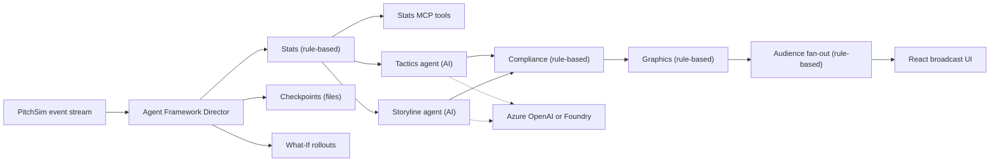

<p align="center"></p>

# Playmakers

Playmakers is a multi-agent TV production crew for football. It reads a live match event stream, works out what matters, explains it with cited evidence, renders timed broadcast overlays, and tailors the output for each viewer. Built for the Inside the Game: Developer Hackathon from Microsoft and the Premier League, in the Best Multi-Agent System category.

Demo video: <YouTube link>
Live demo: https://ca-playmakers-web.mangodune-1ccf56dc.eastus2.azurecontainerapps.io (desktop Chrome or Edge; first load after idle can take about 30 s)

The crew is two AI agents and a set of rule-based steps around them, all in one Microsoft Agent Framework workflow. Tactics and Storyline write with a language model (Storyline also writes the full-time recap). Director, Stats, Compliance, Graphics and Audience are deterministic executors. What-If runs seeded simulations and uses a model only for its one-line explanation.

Built with AI coding assistants under my direction.

## What to look at

- **Multi-agent Director.** A Microsoft Agent Framework workflow runs Stats, then the Tactics and Storyline agents in parallel. Compliance, which is plain code, checks every metric, cited event ID and number in the prose against the deterministic Stats results before Graphics publishes a cue. Models are called only on key moments (shots, goals, fouls, cards, substitutions, kickoff and period changes, plus every 30th event as a tactical beat). Routine events get a rule-written caption built from the verified stats ("Routine pass under light pressure"), which Compliance checks the same way, and the Why? panel says no model was called. A full mock match (seed 7) makes 217 model calls: each writer calls the model on 105 of the match's 1,525 events, plus 6 What-If explanations and the recap.
- **Kill and recover.** Press "Stop Tactics agent" mid-match. This injects a failure into the Tactics executor. A template cue covers the gap, the agent restarts from a checkpoint, replays missed events and catches up. Every step shows in the agent trace. The Tactics row shows Down immediately on click, then holds template cover, checkpoint restoration and catch-up from the real trace for at least 1.5 seconds each. Stop Tactics re-enables after catch-up. The clock and pitch stay at the stop point while the new shared session rebuilds its deterministic prefix. "Restoring from checkpoint…" appears beneath the clock until it advances.
- **Goal threat.** A deterministic pressure model estimates each team’s chance of scoring within two match minutes; the analyst sees both levels and the fan commentary calls High rises in English, Spanish or French. [Synthetic held-out calibration](docs/GOAL-THREAT.md).
- **What-If Lab.** Checked captions stream with their match event before simulations finish, so the score and goal call arrive together. Goals, big chances and red cards trigger 200 seeded match simulations comparing before, after and the counterfactual ("if the shot had been saved"). The card, shown only in the analyst view, sets the actual win chance against the alternative as two bars with the swing in points, and the events behind it are ringed on the pitch for two match minutes. The compact question names the player and moment in English, Spanish or French; shorter desktop layouts leave room for the complete odds and dominance rows.
- **"Why did it say that?"** Every caption has a Why? link. It opens the agent that wrote it, the Compliance verdict (verified, corrected after a rejection, or replaced by a template, with the reason), the supporting events (click one to ring it on the pitch) and the stats it used. What-If cards say plainly that they come from simulations, not Compliance review.
- **Full-time recap.** At the final whistle the Storyline agent writes a recap from the verified score. Compliance checks it and every language variant like any other cue. The recap lists 4–6 key moments (goals and red cards first, then the biggest chances) with timestamps and event IDs, and has Copy and Share-as-text buttons. Works offline with the mock models.
- **Ask the crew.** Ask a mid-match question; answers use only events so far, cite at most 3 events and highlight them on the pitch, with a rule-based offline fallback.
- **Full-match commentary.** The Commentary toggle reads the fan feed in English, French or Spanish, with Azure AI Speech neural voices and browser fallback. Azure batches fresh captions and prefetches audio, retries temporary throttling, and keeps fresh play-by-play between key moments at every speed. Speed changes keep the current match and active commentary; fan language changes select an already-streaming variant. Neither control starts another live-model match. Azure AI Speech is live on the hosted demo.
- **Personalization.** Analyst and For you feeds side by side from one shared match run, with seed 382 as the default demo. The fan feed defaults to English, with Spanish and French one click away, and spotlights the Following player on the pitch. Captions name the players and actions from the referenced events. Both pitch legends distinguish Pass, Incomplete pass, Referenced event and Latest referenced. Recaps list every supplied key moment in one scrollable column.
- **Stats MCP server.** Deterministic metrics (xG, pressure, pass difficulty, momentum) exposed as MCP tools, each result citing event IDs.
- **Honest mock mode.** Without Azure settings the crew runs on an offline mock model. The Agents panel labels "Offline mock model" once in its header and hides model timings. Writers show "Routine play: rule-written caption" for routine events and "Wrote the caption" for model-written insights, while recovery steps keep their coloured status. Up to three rows tint for 1.5 seconds when their action text changes for the latest cue, including the actual count of metric and prose numbers checked by Compliance. Deterministic timings below 1 ms are hidden; other timings are rounded.

## Why multi-agent

The category asks whether specialised agents have distinct roles, coordinate through shared state and handoffs, recover from failures, and deliver something a single agent could not do as well. Concretely:

- **Distinct roles.** Stats computes numbers and never writes prose. Tactics and Storyline write and never compute. Compliance only judges. Graphics only builds schema-valid cues. Audience only shapes cues per viewer. Each step can be tested, timed and replaced on its own.
- **Isolation, kill and recover.** When Tactics fails, only Tactics is down. Graphics publishes a template cue within one event, a circuit breaker probes for recovery, and Tactics restores its Agent Framework checkpoint, replays the key events it missed and catches up. Storyline, Compliance and both feeds keep running throughout. With one agent, any failure blanks the whole broadcast.
- **Parallel writers.** Stats fans out to Tactics and Storyline at the same time (`add_fan_out_edges`), and Compliance fans in (`add_fan_in_edges`). A key moment costs the slower of the two writers, not their sum, and each writer has its own timeout.
- **A gate independent of the writers.** Writers never grade their own work. Compliance is code: every number in the prose must equal a verified metric, every cited event must be in the Stats evidence and include the current event. A rejected draft is retried, up to three attempts, then replaced with a template, and the Why? panel shows which happened. A single model checking itself would share its own blind spots.
- **Per-persona fan-out.** Audience turns one verified insight into an analyst cue and a fan cue (language, favourite player) from the same match run. A live translation that changes any number is rejected in favour of the phrase table.
- **Why one agent would be worse.** A single prompt would have to compute stats, write two voices, check itself, lay out cues and translate, on every event. That is slower (serial), costlier (no cheap rule-written captions for routine events: 217 model calls for a full mock match), less trustworthy (numbers come from the model, not from code) and fragile (one failure takes everything down).

## Architecture



## Microsoft tech used

| Technology | Where in the code | Status |
| --- | --- | --- |
| Microsoft Agent Framework: `WorkflowBuilder` with fan-out/fan-in edges, `Executor`s, `Agent`, `FileCheckpointStorage` | `packages/playmakers_agents/src/playmakers_agents/workflow.py`, `checkpointing.py` | Live. Runs in every mode, including offline and CI |
| Model Context Protocol: custom Stats MCP server and Agent Framework's `MCPStreamableHTTPTool` | `services/stats_mcp/src/stats_mcp/server.py`, mounted at `/stats-mcp` in `services/replay_api/src/replay_api/main.py`; client in `workflow.py` | Server live and tested over streamable HTTP. The workflow calls it only when a live model is configured; offline the same functions run in-process |
| Microsoft Foundry (`FoundryChatClient`) and Azure OpenAI (`OpenAIChatCompletionClient`) | `packages/playmakers_agents/src/playmakers_agents/model_clients.py` | Behind env (`AZURE_AI_PROJECT_ENDPOINT` or `AZURE_OPENAI_ENDPOINT`). Live on the hosted demo (Foundry, `gpt-4.1-mini`). The Azure OpenAI client is unit-tested only |
| Azure Identity (`DefaultAzureCredential`, optional user-assigned managed identity) | `model_clients.py`, `services/replay_api/src/replay_api/speech.py` | Behind env, keyless. Live on the hosted demo through a user-assigned managed identity |
| Application Insights via `azure-monitor-opentelemetry` | `packages/playmakers_agents/src/playmakers_agents/telemetry.py` | Behind `APPLICATIONINSIGHTS_CONNECTION_STRING`. Live on the hosted demo; spans are sampled by Azure Monitor's default rate limit |
| Azure AI Speech | `services/replay_api/src/replay_api/speech.py` | Live on the hosted demo (neural voices in English, French and Spanish, server-side with a daily character cap; browser voice fallback) |
| Azure Container Apps, Log Analytics, Foundry account and model deployment (azd + Bicep) | `infra/` | Deployed with `azd up` to `rg-playmakers-demo` (eastus2) |
| GitHub Actions and GitHub Container Registry | `.github/workflows/ci.yml`, `.github/workflows/images.yml` | Live. Images are public at `ghcr.io/kingemma7/playmakers-{api,web}` |

Not used: GitHub Copilot, Azure MCP Server, Azure Cosmos DB, Azure Event Hubs. State is in memory and checkpoints are local files.

## Hackathon pipeline

| Stage | Where |
| --- | --- |
| Ingest | PitchSim replay over SSE or WebSocket, typed `MatchEvent` schema |
| Interpret | Stats engine and MCP tools, What-If simulations |
| Explain | Tactics and Storyline agents, verified by Compliance |
| Render | Graphics validates each cue against the `OverlayCue` schema (timing, duration, priority, layer, evidence); the React UI draws the cues, and pressing D shows 90% safe-area guides |
| Personalize | Audience fan-out by persona, language and favourite player |

## Quickstart

Needs Python 3.12+ and Node 20.19+. Runs fully offline with mock models; no credentials.

```bash
python3 -m venv .venv && source .venv/bin/activate
pip install -r requirements-dev.txt
for p in packages/playmakers_schema packages/pitchsim packages/playmakers_stats \
         services/stats_mcp packages/playmakers_agents services/replay_api; do pip install -e "$p"; done

uvicorn replay_api.main:app --port 8000      # terminal 1
cd web && npm ci && npm run dev              # terminal 2
```

Open http://localhost:5173. Or run everything with `docker compose up --build`.

Command-line demo with an injected failure:

```bash
python -m playmakers_agents demo --seed 7 --speed 50 --persona analyst --kill tactics@20
```

## Tests

```bash
pytest
cd web && npm test
scripts/verify.sh   # boots API + web, runs the Playwright journey, saves screenshots
                    # (first run: cd web && npx playwright install chromium)
```

## Live models

Set `AZURE_OPENAI_ENDPOINT` and `AZURE_OPENAI_DEPLOYMENT`, or `AZURE_AI_PROJECT_ENDPOINT` and `AZURE_AI_MODEL_DEPLOYMENT` for Foundry. Authentication uses `DefaultAzureCredential`, keyless; set `AZURE_CLIENT_ID` to use a user-assigned managed identity. See [.env.example](.env.example). Without these variables everything runs on the deterministic mock, which is also what CI uses.

With a live model:

- Only key moments call the model (see above). Stats MCP tools are offered to the model only on shots and goals; Stats itself still verifies every metric through MCP, at `http://127.0.0.1:8000/stats-mcp/` inside the API by default (`STATS_MCP_URL` overrides it).
- Timeouts widen to 8 s per insight and 3 s for translation and the What-If explanation (4 s and 1.5 s offline). Override with `PLAYMAKERS_AGENT_TIMEOUT_S`, `PLAYMAKERS_TRANSLATION_TIMEOUT_S` and `PLAYMAKERS_WHATIF_TIMEOUT_S`.
- Tracing: set `APPLICATIONINSIGHTS_CONNECTION_STRING` to send Agent Framework spans (agents, model calls, MCP tools) to Application Insights. It needs the `azure` extra (`pip install -e "services/replay_api[azure]"`), which the API image includes.
- Public limits: at most `PLAYMAKERS_MAX_LIVE_MATCHES` (default 2) live matches at once and `PLAYMAKERS_DAILY_LIVE_MATCHES` (default 15) per UTC day. Further matches still play, on the offline crew, and the header shows "Offline demo". `/speech/tts` (and legacy `/speech/synthesize`) allows 40 requests per minute per caller and 120 in total (`PLAYMAKERS_SPEECH_PER_MINUTE`, `PLAYMAKERS_SPEECH_TOTAL_PER_MINUTE`).
- `WHATIF_WORKERS` sets the What-If process count (default: up to 3 of the CPUs the process may use).

For Azure commentary, set `AZURE_SPEECH_KEY` and `AZURE_SPEECH_REGION` on the server, or use `AZURE_SPEECH_RESOURCE_ID` with the region and optional `AZURE_SPEECH_ENDPOINT` custom subdomain for Microsoft Entra authentication (`DefaultAzureCredential`, Cognitive Services Speech User role). The key stays on the server. `PLAYMAKERS_DAILY_SPEECH_CHARS` defaults to 60,000 characters per UTC day per API process; cached audio is free. The bounded in-memory cache and budget reset on process restart. Unconfigured Speech, exhausted limits or playback failures use browser speech for the session.

## Run on Azure

`infra/` holds an `azd` + Bicep template for the hosted demo in `eastus2`: a Foundry (AIServices) account and project with a `gpt-4.1-mini` GlobalStandard deployment (capacity 50K TPM; change it with `azd env set PLAYMAKERS_MODEL_CAPACITY <n>`), Log Analytics (0.2 GB/day cap) and Application Insights connected to Foundry tracing, a user-assigned managed identity with only the Foundry User (formerly Azure AI User) and Cognitive Services OpenAI User roles on that account, and a Consumption Container Apps environment running the API (1 vCPU, 2 GiB, 0 to 1 replica) and the web app (0 to 1 replica). Both apps pull public images from GHCR, so there is no registry and nothing builds locally. Local auth on the Foundry account is disabled and no key is stored anywhere.

It is deployed: the hosted demo is at https://ca-playmakers-web.mangodune-1ccf56dc.eastus2.azurecontainerapps.io (API at https://ca-playmakers-api.mangodune-1ccf56dc.eastus2.azurecontainerapps.io; `/model/config` reports `{"live": true}`). Images come from `.github/workflows/images.yml`, which builds both on every push and, on main with the repository variable `PUBLISH_IMAGES` set to `true`, pushes them to `ghcr.io/kingemma7/playmakers-{api,web}` tagged `latest` and `sha-<commit>`. The packages are public, so Container Apps pulls them without credentials. To roll out a new build: `az containerapp update -n ca-playmakers-api -g rg-playmakers-demo --image ghcr.io/kingemma7/playmakers-api:sha-<commit>` (and the same for `web`).

Traces: Application Insights `appi-playmakers` (Transaction search, Application map; role `playmakers-api`) and the Foundry project `proj-playmakers` (Tracing). Spans cover the workflow run, each executor, each agent (`invoke_agent tactics`, `storyline`, `what_if`, `audience_translation`), every model call (`chat gpt-41-mini`) and the Stats MCP tool calls. Azure Monitor samples them, so use the deployment's metrics for exact call and token counts.

```bash
cd infra
azd auth login
azd env new playmakers-demo --location eastus2
azd up          # creates rg-playmakers-demo and everything in it
azd down --purge  # teardown
```

The first page load after idle can take about 30 s while the apps scale up from zero. Run `azd env set PLAYMAKERS_ENABLE_SPEECH true` before `azd up` to use the Azure voice through the same Foundry account (adds the Cognitive Services Speech User role).

## Tech stack

Microsoft Agent Framework, Model Context Protocol, FastAPI, Pydantic, React, Vite and TypeScript, Docker and nginx. Azure pieces and their status are in [Microsoft tech used](#microsoft-tech-used).

## Data

All data is synthetic. Clubs, players and crests are fictional, and no Premier League marks are used.

## More

- [Technical details](docs/DETAILS.md): agent internals, recovery, What-If method, API parameters, replay controls, calibration, season dataset, CI
- [Code review](docs/CODE-REVIEW.md)

## License

MIT. See [LICENSE](LICENSE).
