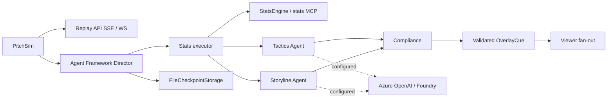

# Gallery — “Inside the Game” Hackathon (Microsoft x Premier League)

**Gallery** is a multi-agent “virtual broadcast production gallery” that turns a live football match event stream into explainable, timed overlay cues and personalized audience output.

This repository is being built for the **Microsoft x Premier League “Inside the Game” developer hackathon**. It uses **synthetic, football-realistic data only**, with **fictional clubs and players** (no Premier League marks).

## Phase 1 (foundation)

Phase 1 ships the foundation:

- **PitchSim**: a deterministic, seeded match-event simulator that produces a full 90-minute match as a timestamped event stream.
- **Shared contracts**: a typed, versioned event schema (JSON Schema + Pydantic).
- **Streaming replay**: a FastAPI service that replays a simulated match over **SSE** or **WebSocket**, in real-time or accelerated (e.g. 10×).
- **Azure-ready stubs**: `azd` + Bicep placeholders for Container Apps, Cosmos DB, Event Hubs (not deployed; no credentials required).
- **CI**: lint + tests run on GitHub Actions.

## Phase 2A (implemented)

The Director is a real Microsoft Agent Framework `WorkflowBuilder` with parallel Tactics
and Storyline Agents, a synchronized Compliance join, Graphics and audience executors.
Every executor emits versioned `AgentTraceEvent` records. Typed shared state uses a
`MatchStore` Protocol and an in-memory implementation; Cosmos is planned for Phase 4.

Stats are code only: possession, pressure index, pass difficulty, xG, momentum and
control vs chaos (normalized pass-network entropy and failed-pass turnover rate).
All results cite event IDs. Compliance recomputes statistics from stored events up to
that event's sequence, verifies metric evidence and numeric prose, and requests at most
two corrections per insight before emitting an evidence-backed template. Graphics
validates the cue schema, including timing, layer and broadcast safe area.

Run offline with no credentials:

```bash
python -m gallery_agents demo --seed 7 --speed 50 --persona analyst
# Quick smoke check; --speed 0 runs without replay waits:
python -m gallery_agents demo --seed 7 --speed 0 --limit 10
python -m stats_mcp
```

The demo prints JSON lines with `type: cue` or `type: trace`. It persists Agent Framework
superstep checkpoints in gitignored `data/checkpoints` (`--checkpoint-dir` overrides it).
The full 90-minute replay takes roughly two minutes at 50× plus workflow overhead.
Standalone MCP is at `http://127.0.0.1:8765/mcp`; the replay API also mounts it at
`http://127.0.0.1:8000/stats-mcp/` and manages its session-manager lifespan.

Default model access uses `DeterministicMockChatClient`, including actual Agent calls.
The mock does not request tools; the offline Stats executor invokes the same pure engine
functions exposed by MCP. When live models are configured, Stats calls MCP through
`MCPStreamableHTTPTool` and checks the results against local evidence. Tactics and
Storyline also receive its read-only tools. Start MCP before running a live-model demo.

Configuration (see [.env.example](.env.example); export variables in your shell):

- Azure OpenAI: `AZURE_OPENAI_ENDPOINT` + `AZURE_OPENAI_DEPLOYMENT`.
- Foundry: `AZURE_AI_PROJECT_ENDPOINT` + `AZURE_AI_MODEL_DEPLOYMENT`.
- `STATS_MCP_URL` optionally selects the standalone or mounted endpoint.

Both live clients use `DefaultAzureCredential` (for example an existing Azure CLI login
locally, managed identity when deployed). Incomplete Azure OpenAI configuration uses
the mock; a Foundry endpoint without a model deployment raises a clear configuration
error. Cloud responses have not been exercised yet; offline tests require no Azure.

Regenerate overlay/trace JSON Schemas with `python -m gallery_agents.export_schemas`.
Schemas are committed under `packages/gallery_schema/src/gallery_schema/schemas/v1/`.

Phase 2B remains: kill/recover, replaying shared state after checkpoint restore, latency
budgets and circuit breakers, What-If rollouts, persona-specific content and translation,
story scripts, and `/gallery/sse` + `/gallery/ws`. The current audience executor stamps
profiles but does not yet translate or simplify captions. The CLI does not yet accept
`--kill`. File checkpoints persist workflow handoffs, not the complete in-memory match store.

## Pipeline fit (hackathon brief)

The hackathon asks for a single pipeline with five stages:

- **Ingest**: Phase 1 replays events via SSE/WS (Phase 2 will add Event Hubs ingestion).
- **Interpret**: Phase 1 emits calibrated match events + ground-truth labels (Phase 2 stats/tactics tools/agents build on this).
- **Explain**: Tactics and Storyline run as Agent Framework Agents, joined by Compliance.
- **Render**: Graphics validates OverlayCue JSON; the visual renderer comes in Phase 3.
- **Personalize**: audience fan-out stamps viewer profiles; content shaping and translation come in Phase 2B.

## Architecture



## Repo layout

- `packages/gallery_schema/`: versioned event contracts (JSON Schema + Pydantic models)
- `packages/pitchsim/`: simulator + validation CLI (`python -m pitchsim ...`)
- `services/replay_api/`: FastAPI SSE/WS replay endpoints
- `packages/gallery_agents/`: Director workflow, typed handoffs, model clients, Compliance and CLI
- `packages/gallery_stats/`: deterministic stats engine with evidence
- `services/stats_mcp/`: streamable HTTP stats tools, standalone or API-mounted
- `infra/`: `azd` + Bicep stubs for Azure resources

## Quickstart (local)

Prereqs: **Python 3.12+**

```bash
cd /path/to/repo
python3 -m venv .venv
source .venv/bin/activate
python -m pip install -U pip

# dev tooling
python -m pip install -r requirements-dev.txt

# editable installs (monorepo)
python -m pip install -e packages/gallery_schema
python -m pip install -e packages/pitchsim
python -m pip install -e packages/gallery_stats
python -m pip install -e services/stats_mcp
python -m pip install -e services/replay_api
python -m pip install -e packages/gallery_agents
python -m pip check
```

### Calibration report (must be within targets)

```bash
python -m pitchsim validate --matches 50
```

### Season-scale synthetic dataset (optional)

Generate a season-like dataset (newline-delimited JSON; output is gitignored by default):

```bash
python -m pitchsim season --matches 380 --out data/season.match_events.jsonl.gz
```

### Live replay (SSE)

Start the API:

```bash
uvicorn replay_api.main:app --reload --port 8000
```

In another shell, connect via SSE (example: 10× speed):

```bash
curl -N "http://127.0.0.1:8000/replay/sse?seed=123&speed=10"
```

### Live replay (WebSocket)

```bash
websocat "ws://127.0.0.1:8000/replay/ws?seed=123&speed=10"
```

## Notes

- **Synthetic-only**: no real match data, no Premier League marks.
- **Deterministic numbers**: downstream explanation agents must cite event IDs; no invented stats.

