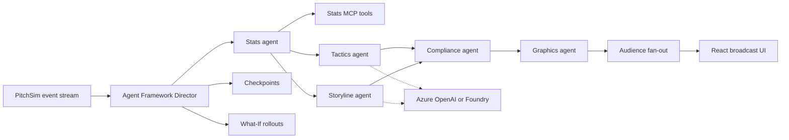

<p align="center"></p>

# Playmakers

Playmakers is a multi-agent TV production crew for football. It reads a live match event stream, works out what matters, explains it with cited evidence, renders timed broadcast overlays, and tailors the output for each viewer. Built for the Microsoft x Premier League "Inside the Game" hackathon.

## What to look at

- **Multi-agent Director.** A Microsoft Agent Framework workflow runs Stats, Tactics and Storyline agents in parallel, joined by a Compliance agent that recomputes every number from stored events before Graphics publishes a cue.
- **Kill and recover.** Press "Stop Tactics agent" mid-match. A template cue covers the gap, the agent restarts from a checkpoint, replays missed events and catches up. Every step shows in the agent trace.
- **What-If Lab.** Goals, big chances and red cards trigger 200 seeded match simulations comparing before, after and the counterfactual ("if the shot had been saved").
- **Personalization.** Analyst and fan feeds side by side from one shared match run, in English, Spanish or French, with favourite-player emphasis.
- **Stats MCP server.** Deterministic metrics (xG, pressure, pass difficulty, momentum) exposed as MCP tools, each result citing event IDs.

## Architecture



## Hackathon pipeline

| Stage | Where |
| --- | --- |
| Ingest | PitchSim replay over SSE or WebSocket, typed `MatchEvent` schema |
| Interpret | Stats engine and MCP tools, What-If simulations |
| Explain | Tactics and Storyline agents, verified by Compliance |
| Render | Graphics validates `OverlayCue` timing and safe areas; React canvas overlays |
| Personalize | Audience fan-out by persona, language and favourites |

## Quickstart

Needs Python 3.12+ and Node 20.19+. Runs fully offline with mock models; no credentials.

```bash
python3 -m venv .venv && source .venv/bin/activate
pip install -r requirements-dev.txt
for p in packages/playmakers_schema packages/pitchsim packages/playmakers_stats \
         services/stats_mcp packages/playmakers_agents services/replay_api; do pip install -e "$p"; done

uvicorn replay_api.main:app --port 8000      # terminal 1
cd web && npm ci && npm run dev              # terminal 2
```

Open http://localhost:5173. Or run everything with `docker compose up --build`.

Command-line demo with an injected failure:

```bash
python -m playmakers_agents demo --seed 7 --speed 50 --persona analyst --kill tactics@20
```

## Tests

```bash
pytest
cd web && npm test
```

## Live models

Set `AZURE_OPENAI_ENDPOINT` and `AZURE_OPENAI_DEPLOYMENT`, or `AZURE_AI_PROJECT_ENDPOINT` and `AZURE_AI_MODEL_DEPLOYMENT` for Foundry. Authentication uses `DefaultAzureCredential`. See [.env.example](.env.example).

## Tech stack

Microsoft Agent Framework, Azure OpenAI and Microsoft Foundry (configured via environment), Model Context Protocol, FastAPI, React, Vite and TypeScript, Docker, with `azd` and Bicep scaffolding for Azure Container Apps.

## Data

All data is synthetic. Clubs, players and crests are fictional, and no Premier League marks are used.

## More

- [Technical details](docs/DETAILS.md): agent internals, recovery, What-If method, API parameters, replay controls, calibration, season dataset, CI
- [Code review](docs/CODE-REVIEW.md)

## License

MIT. See [LICENSE](LICENSE).
