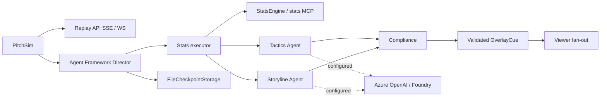

# Gallery — “Inside the Game” Hackathon (Microsoft x Premier League)

**Gallery** is a multi-agent “virtual broadcast production gallery” that turns a live football match event stream into explainable, timed overlay cues and personalized audience output.

This repository is being built for the **Microsoft x Premier League “Inside the Game” developer hackathon**. It uses **synthetic, football-realistic data only**, with **fictional clubs and players** (no Premier League marks).

## Phase 1 (foundation)

Phase 1 ships the foundation:

- **PitchSim**: a deterministic, seeded match-event simulator that produces a full 90-minute match as a timestamped event stream.
- **Shared contracts**: a typed, versioned event schema (JSON Schema + Pydantic).
- **Streaming replay**: a FastAPI service that replays a simulated match over **SSE** or **WebSocket**, in real-time or accelerated (e.g. 10×).
- **Azure-ready stubs**: `azd` + Bicep placeholders for Container Apps, Cosmos DB, Event Hubs (not deployed; no credentials required).
- **CI**: lint + tests run on GitHub Actions.

## Phase 2A (implemented)

The Director is a real Microsoft Agent Framework `WorkflowBuilder` with parallel Tactics
and Storyline Agents, a synchronized Compliance join, Graphics and audience executors.
Every executor emits versioned `AgentTraceEvent` records. Typed shared state uses a
`MatchStore` Protocol and an in-memory implementation; Cosmos is planned for Phase 4.

Stats are code only: possession, pressure index, pass difficulty, xG, momentum and
control vs chaos (normalized pass-network entropy and failed-pass turnover rate).
All results cite event IDs. Compliance recomputes statistics from stored events up to
that event's sequence, verifies metric evidence and numeric prose, and requests at most
two corrections per insight before emitting an evidence-backed template. Graphics
validates the cue schema, including timing, layer and broadcast safe area.

Run offline with no credentials:

```bash
python -m gallery_agents demo --seed 7 --speed 50 --persona analyst
# Quick smoke check; --speed 0 runs without replay waits:
python -m gallery_agents demo --seed 7 --speed 0 --limit 10
python -m stats_mcp
```

The demo prints JSON lines with `type: cue` or `type: trace`. It persists Agent Framework
superstep checkpoints in gitignored `data/checkpoints` (`--checkpoint-dir` overrides it).
The full 90-minute replay takes roughly two minutes at 50× plus workflow overhead.
Standalone MCP is at `http://127.0.0.1:8765/mcp`; the replay API also mounts it at
`http://127.0.0.1:8000/stats-mcp/` and manages its session-manager lifespan.

Default model access uses `DeterministicMockChatClient`, including actual Agent calls.
The mock does not request tools; the offline Stats executor invokes the same pure engine
functions exposed by MCP. When live models are configured, Stats calls MCP through
`MCPStreamableHTTPTool` and checks the results against local evidence. Tactics and
Storyline also receive its read-only tools. Start MCP before running a live-model demo.

Configuration (see [.env.example](.env.example); export variables in your shell):

- Azure OpenAI: `AZURE_OPENAI_ENDPOINT` + `AZURE_OPENAI_DEPLOYMENT`.
- Foundry: `AZURE_AI_PROJECT_ENDPOINT` + `AZURE_AI_MODEL_DEPLOYMENT`.
- `STATS_MCP_URL` optionally selects the standalone or mounted endpoint.

Both live clients use `DefaultAzureCredential` (for example an existing Azure CLI login
locally, managed identity when deployed). Incomplete Azure OpenAI configuration uses
the mock; a Foundry endpoint without a model deployment raises a clear configuration
error. Cloud responses have not been exercised yet; offline tests require no Azure.

Regenerate overlay/trace JSON Schemas with `python -m gallery_agents.export_schemas`.
Schemas are committed under `packages/gallery_schema/src/gallery_schema/schemas/v1/`.

## How the agents work (Phase 2B)

```mermaid
sequenceDiagram
    participant Replay as PitchSim / Replay API
    participant Director
    participant Stats as Stats / MCP
    participant Writers as Tactics + Storyline
    participant Compliance
    participant Graphics
    participant Audience
    participant Checkpoint as Framework file storage
    Replay->>Director: Seeded MatchEvent
    Director->>Stats: Compute evidence-backed metrics
    Stats->>Writers: Parallel explanation requests
    Writers->>Compliance: Typed insights + evidence IDs
    Compliance->>Writers: Up to two corrections, within deadline
    Compliance->>Graphics: Verified insights or deterministic templates
    Graphics->>Audience: Schema-validated cues
    Audience-->>Replay: Analyst / casual / en, es, fr cues + traces
    Director->>Checkpoint: Match history + per-agent sequence
    opt Tactics fails or exceeds its deadline
        Director->>Graphics: Template on the same event
        Director->>Checkpoint: Load last successful agent sequence
        Director->>Writers: Recreate Tactics; replay missed events
        Writers->>Compliance: Verify replay before resuming
    end
    opt Goal, big chance, or red card
        Director->>Director: What-If: parallel seeded PitchSim continuations
        Director->>Audience: Before / after / counterfactual probabilities
    end
```

**Kill and recover:** Tactics has a 4-second deadline, shared across generation and
correction attempts; Graphics has a 1.5-second deadline. Exceptions and timeouts open
a circuit breaker. A failed Tactics branch immediately supplies an evidence-backed
`template_fallback` cue; Storyline continues. The next event probes recovery. Repeated
failures back off for 1, 2, 4, 8, then 16 events. Traces expose `agent_down`, `fallback_on`,
`restarted_from_checkpoint`, and `caught_up`. Catch-up results pass Compliance and are
not rebroadcast as stale cues.

Framework `FileCheckpointStorage` saves both workflow supersteps and a versioned
match-history/agent-progress checkpoint. `RecoveryStorage` separates restoration from
its backend; a fresh Director can call `await director.restore(match_id)` before
consuming later events. Checkpoint folders are local development data, not a multi-user
service database. API sessions use isolated temporary folders cleaned on disconnect;
CLI checkpoints persist in `data/checkpoints`. Cosmos durability comes in Phase 4.

**What-If:** goals, non-goal shots with xG > 0.3, and red cards trigger 200 rollouts per
scenario by default. Three process workers compare the event prefix before, after, and
counterfactual at the same clock using common per-rollout seeds. Goal counterfactual:
“if the shot had been saved”; big chance: “if the chance had been scored”; red card:
“if the red card had not been shown”. `payload.metrics` includes `before`, `after`,
`counterfactual` win/draw/loss distributions, `win_prob_before`, `win_prob_after`, `delta`,
and `rollouts`. All probabilities refer to the **home team**. The explanation uses the
model-client interface, including the deterministic offline mock. A local first-goal
benchmark with 200 rollouts took **1.70s including worker startup**; hardware and live
model latency vary. These are approximate PitchSim continuations, not calibrated real
football forecasts; story-driven style changes beyond observed red cards are not yet
reconstructed in snapshots.

**Two audiences:** Analyst cues retain full verified metrics and tactical labels.
Casual cues use shorter emotional captions, fewer numbers, and ★ favourite-team/player
emphasis; `player_cam` appears only when that viewer's favourite is involved in the event.
English, Spanish and French work offline through a small phrase table. Configured live
models translate captions, with phrase-table fallback on timeout or invalid output.

Run the signature demo or a short recovery smoke check:

```bash
python -m gallery_agents demo --seed 7 --speed 50 --persona analyst --kill tactics@20
python -m gallery_agents demo --speed 0 --limit 5 --kill tactics@0 --whatif-rollouts 20
python -m gallery_agents demo --speed 50 --persona casual --language es --favourite-player-id match_7_H09
python -m gallery_agents demo --seed 7 --story stories/press_collapse.yaml --speed 50
python -m pitchsim simulate --seed 7 --story stories/late_comeback.yaml
```

`stories/*.yaml` applies deterministic style changes and plants persistent labels from
the scripted minute for later evaluation. `late_comeback` plants a comeback **attempt**,
not a guaranteed scoreline.

Start `uvicorn replay_api.main:app --port 8000`, then:

```bash
curl -N "http://localhost:8000/gallery/sse?seed=7&speed=50&persona=casual&language=es&kill=tactics@20&whatif_rollouts=200"
websocat "ws://localhost:8000/gallery/ws?seed=7&speed=50&persona=analyst&kill=tactics@20"
```

Both endpoints accept `seed`, `speed` (0 = no waits), `persona`, `language`,
`favourite_team_id`, `favourite_player_id`, `kill`, and `whatif_rollouts` (1–2000).
Messages are flat JSON objects with `type: "event" | "cue" | "trace"`; SSE uses ordinary
`data:` frames suitable for `EventSource.onmessage`. CORS allows `http://localhost:5173`.
The stats MCP service remains mounted at `/stats-mcp/`.

Validation: 40 offline tests cover the workflow, recovery/replay, timeout/crash backoff,
What-If determinism, personalization, translation fallback, scripts and SSE/WS/MCP.
The full seed-7 kill demo emits 3,147 cues and 9,428 traces, with one fallback cue and
nine What-If cards. Ruff, calibration and dependency checks pass; a clean Python 3.13
virtual environment also installs and passes the suite.

## Pipeline fit (hackathon brief)

The hackathon asks for a single pipeline with five stages:

- **Ingest**: Phase 1 replays events via SSE/WS (Phase 2 will add Event Hubs ingestion).
- **Interpret**: Phase 1 emits calibrated match events + ground-truth labels (Phase 2 stats/tactics tools/agents build on this).
- **Explain**: Tactics and Storyline run as Agent Framework Agents, joined by Compliance.
- **Render**: Graphics validates OverlayCue JSON; the visual renderer comes in Phase 3.
- **Personalize**: audience fan-out shapes metrics, captions, favourites and language for each profile.

## Architecture



## Repo layout

- `packages/gallery_schema/`: versioned event contracts (JSON Schema + Pydantic models)
- `packages/pitchsim/`: simulator + validation CLI (`python -m pitchsim ...`)
- `services/replay_api/`: FastAPI SSE/WS replay endpoints
- `packages/gallery_agents/`: Director workflow, typed handoffs, model clients, Compliance and CLI
- `packages/gallery_stats/`: deterministic stats engine with evidence
- `services/stats_mcp/`: streamable HTTP stats tools, standalone or API-mounted
- `infra/`: `azd` + Bicep stubs for Azure resources

## Quickstart (local)

Prereqs: **Python 3.12+**

```bash
cd /path/to/repo
python3 -m venv .venv
source .venv/bin/activate
python -m pip install -U pip

# dev tooling
python -m pip install -r requirements-dev.txt

# editable installs (monorepo)
python -m pip install -e packages/gallery_schema
python -m pip install -e packages/pitchsim
python -m pip install -e packages/gallery_stats
python -m pip install -e services/stats_mcp
python -m pip install -e packages/gallery_agents
python -m pip install -e services/replay_api
python -m pip check
```

### Calibration report (must be within targets)

```bash
python -m pitchsim validate --matches 50
```

### Season-scale synthetic dataset (optional)

Generate a season-like dataset (newline-delimited JSON; output is gitignored by default):

```bash
python -m pitchsim season --matches 380 --out data/season.match_events.jsonl.gz
```

### Live replay (SSE)

Start the API:

```bash
uvicorn replay_api.main:app --reload --port 8000
```

In another shell, connect via SSE (example: 10× speed):

```bash
curl -N "http://127.0.0.1:8000/replay/sse?seed=123&speed=10"
```

### Live replay (WebSocket)

```bash
websocat "ws://127.0.0.1:8000/replay/ws?seed=123&speed=10"
```

## Notes

- **Synthetic-only**: no real match data, no Premier League marks.
- **Deterministic numbers**: downstream explanation agents must cite event IDs; no invented stats.

