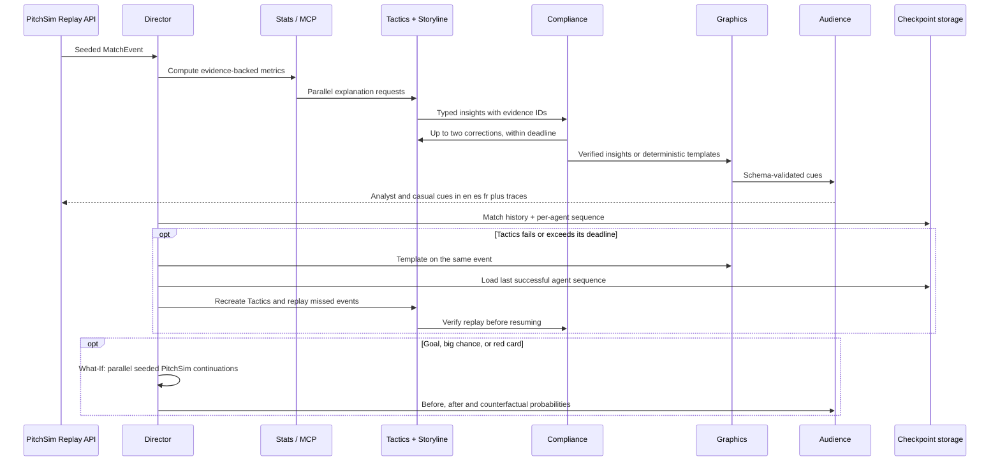
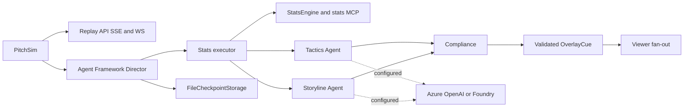
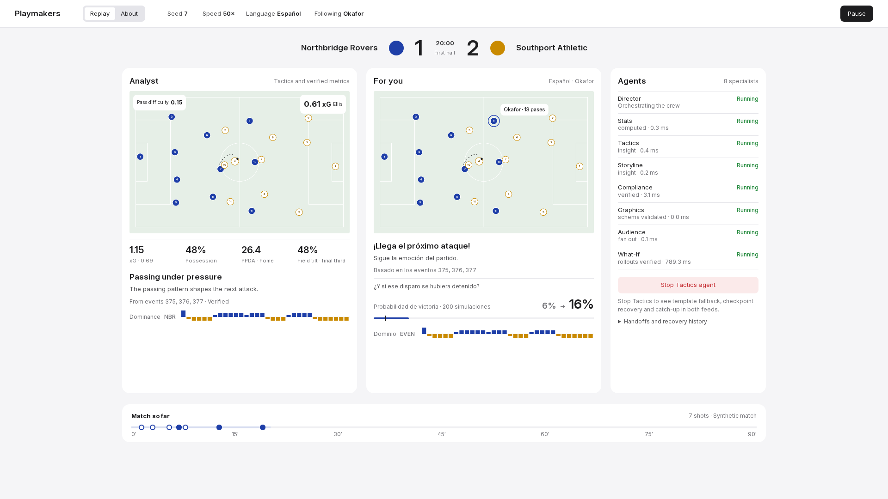

# Playmakers: technical details

Full reference moved from the README. See [README](../README.md) for the overview.

**Playmakers** is an AI production crew that turns a live football match event stream into explainable, timed overlay cues and personalized audience output.

This repository is being built for the **Microsoft x Premier League “Inside the Game” developer hackathon**. It uses **synthetic, football-realistic data only**, with **fictional clubs and players** (no Premier League marks).

## Phase 1 (foundation)

Phase 1 ships the foundation:

- **PitchSim**: a deterministic, seeded match-event simulator that produces a full 90-minute match as a timestamped event stream.
- **Shared contracts**: a typed, versioned event schema (JSON Schema + Pydantic).
- **Streaming replay**: a FastAPI service that replays a simulated match over **SSE** or **WebSocket**, in real-time or accelerated (e.g. 10×).
- **Azure template**: `azd` + Bicep for Foundry, Application Insights and Container Apps (see the README "Run on Azure" section; validated locally, not deployed).
- **CI**: lint + tests run on GitHub Actions.

## Phase 2A (implemented)

The Director is a real Microsoft Agent Framework `WorkflowBuilder` with parallel Tactics
and Storyline Agents, a synchronized Compliance join, Graphics and audience executors.
Every executor emits versioned `AgentTraceEvent` records. Typed shared state uses a
`MatchStore` Protocol and an in-memory implementation. There is no database: a Cosmos DB
store was planned early on and never built.

Stats are code only: possession, pressure index, pass difficulty, xG, momentum and
control vs chaos (normalized pass-network entropy and failed-pass turnover rate).
All results cite event IDs. Compliance checks each insight against the Stats packet that the
deterministic engine computed from stored events up to that event, verifies metric evidence and numeric prose, and requests at most
two corrections per insight before emitting an evidence-backed template. Graphics
validates the cue schema, including timing, layer and broadcast safe area.

Run offline with no credentials:

```bash
python -m playmakers_agents demo --seed 7 --speed 50 --persona analyst
# Quick smoke check; --speed 0 runs without replay waits:
python -m playmakers_agents demo --seed 7 --speed 0 --limit 10
python -m stats_mcp
```

The demo prints JSON lines with `type: cue` or `type: trace`. It persists Agent Framework
superstep checkpoints in gitignored `data/checkpoints` (`--checkpoint-dir` overrides it).
The full 90-minute replay takes roughly two minutes at 50× plus workflow overhead.
Standalone MCP is at `http://127.0.0.1:8765/mcp`; the replay API also mounts it at
`http://127.0.0.1:8000/stats-mcp/` and manages its session-manager lifespan.

Default model access uses `DeterministicMockChatClient`, including actual Agent calls.
The mock does not request tools; the offline Stats executor invokes the same pure engine
functions exposed by MCP. When live models are configured, Stats calls MCP through
`MCPStreamableHTTPTool` and checks the results against local evidence. Tactics and
Storyline receive its read-only tools on shots and goals only. Inside the API, MCP is
mounted at `/stats-mcp/`, which is the live default (`http://127.0.0.1:8000/stats-mcp/`).

**Key-moment gate:** Tactics and Storyline call the model only for shots, goals, fouls,
cards, substitutions, kickoff and period events, and every 30th event (a tactical beat).
Other events get a rule-written insight from the verified metrics (for example "Routine pass
under light pressure / Northbridge Rovers keep the ball moving; this pass rated 0.08 for
difficulty."), which goes through the same
Compliance check and carries provenance `source: template, compliance: verified`; the
trace shows `templated`. Kill-recover replays only gated events. Measured with the mock
and two viewer profiles: 217 model calls for seed 7 and 180 for seed 42 (105 and 89
events per agent, 6 and 1 What-If explanations, one recap), down from 2,992 and 3,196.
`tests/test_model_gate.py` pins the seed-7 count.

Configuration (see [.env.example](../.env.example); export variables in your shell):

- Azure OpenAI: `AZURE_OPENAI_ENDPOINT` + `AZURE_OPENAI_DEPLOYMENT`.
- Foundry: `AZURE_AI_PROJECT_ENDPOINT` + `AZURE_AI_MODEL_DEPLOYMENT`.
- `PLAYMAKERS_DAILY_ASK_MODEL_CALLS` caps question model calls per UTC day per API process (default 60); questions use rules after the cap, independently of the live-match budget.
- `STATS_MCP_URL` selects another endpoint, such as the standalone server (`http://127.0.0.1:8765/mcp`).
- `AZURE_CLIENT_ID` selects a user-assigned managed identity.
- `PLAYMAKERS_AGENT_TIMEOUT_S`, `PLAYMAKERS_TRANSLATION_TIMEOUT_S`, `PLAYMAKERS_WHATIF_TIMEOUT_S` (live defaults 8, 3, 3 seconds).
- `APPLICATIONINSIGHTS_CONNECTION_STRING` turns on Azure Monitor tracing with Agent Framework instrumentation (`PLAYMAKERS_TRACE_CONTENT=0` leaves prompts and responses out).

Both live clients use `DefaultAzureCredential` (for example an existing Azure CLI login
locally, managed identity when deployed). Incomplete Azure OpenAI configuration uses
the mock; a Foundry endpoint without a model deployment raises a clear configuration
error. Cloud responses have not been exercised yet; offline tests require no Azure.

Regenerate overlay/trace JSON Schemas with `python -m playmakers_agents.export_schemas`.
Schemas are committed under `packages/playmakers_schema/src/playmakers_schema/schemas/v1/`.

## How the agents work (Phase 2B)



**Kill and recover:** Tactics has a 4-second deadline offline (8 seconds with a live
model), shared across generation and correction attempts; Graphics has a 1.5-second deadline. Exceptions and timeouts open
a circuit breaker. A failed Tactics branch immediately supplies an evidence-backed
`template_fallback` cue; Storyline continues. The next event probes recovery. Repeated
failures back off for 1, 2, 4, 8, then 16 events. Traces expose `agent_down`, `fallback_on`,
`restarted_from_checkpoint`, and `caught_up`. Catch-up results pass Compliance and are
not rebroadcast as stale cues.

Framework `FileCheckpointStorage` saves both workflow supersteps and a versioned
match-history/agent-progress checkpoint on the first event, every 25 sequences, kill/recovery boundaries and full time. Agent progress stays current in memory between saves. After a crash, restore the last checkpoint and replay the unsaved tail. `RecoveryStorage` separates restoration from
its backend; a fresh Director can call `await director.restore(match_id)` before
consuming later events. Checkpoint folders are local development data, not a multi-user
service database. API sessions use isolated temporary folders cleaned on disconnect;
CLI checkpoints persist in `data/checkpoints`. There is no durable cloud checkpoint store.

**What-If:** goals, non-goal shots with xG > 0.3, and red cards trigger 200 rollouts per
scenario by default. Three process workers compare the event prefix before, after, and
counterfactual at the same clock using common per-rollout seeds. Goal counterfactual:
“if the shot had been saved”; big chance: “if the chance had been scored”; red card:
“if the red card had not been shown”. `payload.metrics` includes `before`, `after`,
`counterfactual` win/draw/loss distributions, `win_prob_before`, `win_prob_after`, `delta`,
and `rollouts`. All probabilities refer to the **home team**. The explanation uses the
model-client interface, including the deterministic offline mock. A local first-goal
benchmark with 200 rollouts took **1.70s including worker startup**; hardware and live
model latency vary. These are approximate PitchSim continuations, not calibrated real
football forecasts; story-driven style changes beyond observed red cards are not yet
reconstructed in snapshots.

**Two audiences:** Analyst cues retain full verified metrics and tactical labels.
Casual cues use shorter emotional captions, fewer numbers, and ★ favourite-team/player
emphasis; `player_cam` appears only when that viewer's favourite is involved in the event.
English, Spanish and French work offline through a small phrase table. Configured live
models translate captions, with phrase-table fallback on timeout or invalid output.

Run the signature demo or a short recovery smoke check:

```bash
python -m playmakers_agents demo --seed 7 --speed 50 --persona analyst --kill tactics@20
python -m playmakers_agents demo --speed 0 --limit 5 --kill tactics@0 --whatif-rollouts 20
python -m playmakers_agents demo --speed 50 --persona casual --language es --favourite-player-id match_7_H09
python -m playmakers_agents demo --seed 7 --story stories/press_collapse.yaml --speed 50
python -m pitchsim simulate --seed 7 --story stories/late_comeback.yaml
```

`stories/*.yaml` applies deterministic style changes and plants persistent labels from
the scripted minute for later evaluation. `late_comeback` plants a comeback **attempt**,
not a guaranteed scoreline.

Start `uvicorn replay_api.main:app --port 8000`, then:

```bash
curl -N "http://localhost:8000/playmakers/sse?seed=7&speed=50&persona=casual&language=es&kill=tactics@20&whatif_rollouts=200"
websocat "ws://localhost:8000/playmakers/ws?seed=7&speed=50&persona=analyst&kill=tactics@20"
```

Both endpoints accept `seed`, `speed` (0 = no waits), `persona`, `language`,
`favourite_team_id`, `favourite_player_id`, `kill`, and `whatif_rollouts` (1–2000).
Messages are flat JSON objects with `type: "event" | "cue" | "trace"`; SSE uses ordinary
`data:` frames suitable for `EventSource.onmessage`. CORS defaults to `http://localhost:5173`; set `CORS_ORIGINS` to a comma-separated allowlist before starting the API.
The stats MCP service remains mounted at `/stats-mcp/`.

Cues may carry an optional `provenance` object (agent, source, Compliance verdict, attempts,
rejection reasons, metrics used and the events behind each metric). At the final whistle the
stream adds one `recap` cue per viewer profile (priority 90, 30 s, payload `headline`,
`detail`, `home_goals`, `away_goals` and `moments`). `GET /model/config` returns
`{"live": true|false}` so the Agents header can show "Offline mock model" once and hide
millisecond timings for Tactics, Storyline and What-If when no live model is configured.
`GET /speech/config` reports Azure AI Speech availability, `azure_per_minute`, and remaining daily characters.
`POST /speech/tts` accepts `{text, language: "en"|"es"|"fr", emphasis: "normal"|"goal"|"big"}`
(up to 4,000 characters) and returns MP3 audio; unconfigured Speech returns 503 `unconfigured`.
Legacy `GET /speech/synthesize?text=…&language=en|es|fr` remains supported with
`X-Playmakers-Speech: 1` and its 280-character limit. Set server-only `AZURE_SPEECH_KEY`
and `AZURE_SPEECH_REGION`, or the existing Entra `AZURE_SPEECH_RESOURCE_ID` path
(with optional `AZURE_SPEECH_ENDPOINT`). Voices are Ryan (English), Henri (French),
and Alvaro (Spanish), with SSML prosody for key moments. `PLAYMAKERS_DAILY_SPEECH_CHARS`
defaults to 60,000 per UTC day per API process; a 256-entry LRU makes repeated audio free.
`PLAYMAKERS_SPEECH_AZURE_PER_MINUTE` defaults to 18 uncached Azure calls per minute,
shared by all viewers in a process through a token bucket; cache hits use no tokens.
The budget, bucket and cache are in memory and reset on process restart. Rate limits default to
40 requests per client per minute and 120 total. The web Commentary queue speaks the
selected fan language, prioritizes goals, red cards, What-If, recap and recovery notices,
drops stale routine captions, and suppresses routine speech at 50× or higher. Azure routine starts are paced to the configured rate (about 3.4 seconds by default);
key lines bypass pacing. A 429 `busy` (bucket empty or Azure throttled) drops routine
lines or uses the browser for that key line, keeping Azure active. Daily-cap 429s and
other failures switch to browser speech for the rest of the session. Browser speech is unpaced. No live Azure validation
has been performed.

Validation: 40 offline tests cover the workflow, recovery/replay, timeout/crash backoff,
What-If determinism, personalization, translation fallback, scripts and SSE/WS/MCP.
The full seed-7 kill demo emits 3,147 cues and 9,428 traces, with one fallback cue and
nine What-If cards. Ruff, calibration and dependency checks pass; a clean Python 3.13
virtual environment also installs and passes the suite.

## Pipeline fit (hackathon brief)

The hackathon asks for a single pipeline with five stages:

- **Ingest**: PitchSim events are replayed over SSE/WS.
- **Interpret**: Phase 1 emits calibrated match events + ground-truth labels (Phase 2 stats/tactics tools/agents build on this).
- **Explain**: Tactics and Storyline run as Agent Framework Agents, joined by Compliance.
- **Render**: Graphics validates OverlayCue JSON; the visual renderer comes in Phase 3.
- **Personalize**: audience fan-out shapes metrics, captions, favourites and language for each profile.

## Architecture



## Repo layout

- `packages/playmakers_schema/`: versioned event contracts (JSON Schema + Pydantic models)
- `packages/pitchsim/`: simulator + validation CLI (`python -m pitchsim ...`)
- `services/replay_api/`: FastAPI SSE/WS replay endpoints
- `packages/playmakers_agents/`: Director workflow, typed handoffs, model clients, Compliance and CLI
- `packages/playmakers_stats/`: deterministic stats engine with evidence
- `services/stats_mcp/`: streamable HTTP stats tools, standalone or API-mounted
- `infra/`: `azd` + Bicep stubs for Azure resources

## Quickstart (local)

Prereqs: **Python 3.12+**

```bash
cd /path/to/repo
python3 -m venv .venv
source .venv/bin/activate
python -m pip install -U pip

# dev tooling
python -m pip install -r requirements-dev.txt

# editable installs (monorepo)
python -m pip install -e packages/playmakers_schema
python -m pip install -e packages/pitchsim
python -m pip install -e packages/playmakers_stats
python -m pip install -e services/stats_mcp
python -m pip install -e packages/playmakers_agents
python -m pip install -e services/replay_api
python -m pip check
```

### Calibration report (must be within targets)

```bash
python -m pitchsim validate --matches 50
```

### Season-scale synthetic dataset (optional)

Generate a season-like dataset (newline-delimited JSON; output is gitignored by default):

```bash
python -m pitchsim season --matches 380 --out data/season.match_events.jsonl.gz
```

### Live replay (SSE)

Start the API:

```bash
uvicorn replay_api.main:app --reload --port 8000
```

In another shell, connect via SSE (example: 10× speed):

```bash
curl -N "http://127.0.0.1:8000/replay/sse?seed=123&speed=10"
```

### Live replay (WebSocket)

```bash
websocat "ws://127.0.0.1:8000/replay/ws?seed=123&speed=10"
```

## Notes

- **Synthetic-only**: no real match data, no Premier League marks.
- **Deterministic numbers**: downstream explanation agents must cite event IDs; no invented stats.


## Playmakers broadcast UI (Phase 3)

The React + Vite + TypeScript Playmakers app shows **Analyst** and **Fan** feeds side by side,
with a shared event clock, a Canvas pitch, timed evidence-backed overlays and a live agent trace.
All clubs and crest shapes are fictional. `/about` explains the architecture and current deployment status.

With the Python packages installed using the instructions above, run these in separate terminals:

```bash
# Repository root; offline mock models require no credentials
uvicorn replay_api.main:app --port 8000

# Frontend (Node 20.19+)
cd web
npm ci
npm run dev
```

Open **http://localhost:5173**. `VITE_API_BASE` defaults to `http://localhost:8000`;
set it in `web/.env.local` for another API origin. Set `CORS_ORIGINS` on the API to allow other web origins (default `http://localhost:5173`). The client uses one EventSource per audience, backed by one shared Director and 200-rollout What-If session, and retries
with bounded backoff and deduplicates the deterministic replay after reconnection.
The slower stream determines the shared event clock.

- Choose seed and speed (1×, 10×, 50×). Only a seed change restarts the match. Speed updates the existing producer through `POST /playmakers/pace`; it wakes the current pacing delay without rebuilding the Director or clearing either feed, recap, What-If, trace or commentary.
- Fan controls select English (the default), Spanish or French and a fictional roster number. Changing the fan
  language selects among variants already arriving on the fan stream, preserving the clock and history. Changing the favourite player rebuilds the viewer configuration.
- Pause freezes the displayed program; network feeds continue buffering. Start returns to live.
- Toggle safe-area guides. Cue timing uses the match clock, duration, priority and one winner per slot.
- **Stop Tactics agent** restarts both deterministic sessions with failure at the current minute.
  The API fast-forwards the prefix (`replay_from_ms`) before returning to the selected pace.
  Look for `agent down → fallback on → restarted from checkpoint → caught up` in both feeds.
  The button re-enables after the displayed catch-up step; each stop rebuilds the session with one injected failure.
- Score/clock, storyline/tactical lower thirds, momentum, pass difficulty, xG shots,
  favourite tags and What-If probability cards respond to actual events/cues.



Screenshot/GIF placeholder for the submission: replace or supplement this capture with
`docs/media/hero.png` and a short kill/recover recording once the final theme is locked.

```bash
cd web
npm run types:generate   # json-schema-to-typescript; output in src/generated is versioned
npm run lint
npm test
npm run build
npx playwright install chromium
npm run screenshot      # API :8000 + Vite :5173 must already be running
```

The Chromium script captures `web/e2e-screenshot.png` at 1920×1080 and checks live persona
content, the shared clock, pause/start, kill/recover traces and `/about`. It also saves
1440×900 captures to `web/shots/main.png` (mid-match insights), `kill.png` (recovery)
and `about.png`, and asserts no horizontal overflow at both viewport sizes.
The Calm light theme uses locally bundled Inter (SIL OFL), a single `web/src/tokens.css`
for design tokens, a shared scoreboard, two audience cards, an Agents list with expandable
handoff history, and an event-driven match timeline. On restricted
machines use `PLAYWRIGHT_BROWSERS_PATH=/tmp/playmakers-playwright` for both installation and execution.
Set `PLAYMAKERS_WEB_URL` to override the screenshot target URL (default `http://localhost:5173`).
CI runs npm ci, contract drift detection, lint, unit tests and production build on Node 20.

Current visual limits: PitchSim emits ball/action positions but no full player tracking frames
in its default replay. The 22 dots therefore use formation-based motion around the observed ball
(`web/src/pitchModel.ts`, mirroring `packages/pitchsim/src/pitchsim/shape.py`); tracking frames
are used when present. Each event becomes a ball movement: passes travel from the passer to the
receiver, who runs onto the ball; carries move with the player on the ball; shots go to the goal,
the keeper or wide of the post; goals and goal kicks restart with a short fade. Players are keyed
by player ID, ease towards their targets with a speed cap, and keep their shirt numbers; a
substitute takes the place of the player he replaces. The canvas has a margin so the goals and
touchline players are never clipped, and `prefers-reduced-motion` jumps straight to each state.
PitchSim itself keeps the ball in play (deep balls are cut back, wide ones folded in), makes the
player on the ball the one who passes, carries or shoots, picks the receiver whose formation slot
is nearest the target, and hands the ball to the defending team after a save, block or miss. Pause/resume is a local program freeze, not server pause.

Grounding in real data. Team shape, pass geometry and the keeper's position are fitted to open
tracking data from Metrica Sports (sample games 1 and 2, https://github.com/metrica-sports/sample-data,
used with acknowledgement as its README asks). Only aggregates are kept, in
`tests/reference/metrica_derived.json` (no raw rows): ball time per third (22/51/26%) and channel
(33/32/35%), pass length (median 13.8 m), lateral and forward pass components, runs of consecutive
passes in one zone, team width (median 42 m in possession, 37 m out of it), depth, back-line height,
keeper distance off the line (median 3.8 m with the ball in his third) and how far he follows the
ball across (about a tenth of its offset), plus ball speed per pass (median 11.7 m/s, faster for
longer passes) and shot flight time (median 0.86 s). `tests/test_pitch_spread.py` checks PitchSim
and `shape.slot` against those ranges. In possession the team stretches and the wide players hold
the touchline; out of possession it is compact and shifts to the ball side; build-up pushes the ball
out of the back, attacks that stall are reset to the back line, and wide players switch play to the
far side. On the web pitch the ball flies at a speed proportional to the real speed for that pass
length, the nearest defender presses the player on the ball, the keeper stays on the ball-to-goal
line and moves (and dives) to the shot, and the analyst cards sit in the heading strip, off the pitch.
Reconnect rebuilds ephemeral server sessions rather than resuming a stored session. Offline fan
translations use the small phrase table. What-If probabilities remain synthetic approximations.
The Azure template in `infra/` and Application Insights tracing are written and validated
locally but have not been deployed or run against Azure. There is no database.

What-If snapshots now replay scripted style-change metadata from events (including YAML stories),
as well as red cards. A supplied story schedule supports older recordings and future rollout changes;
recorded changes take precedence so they are not applied twice.

### Calm replay controls

While a panel has no match event, a translucent loading scrim covers its pitch and
content below, leaving the header controls available. It appears after 250 ms,
stays visible for at least 400 ms, then fades out over 180 ms. Reconnection uses
the same timing; reduced motion disables the spinner animation and fade.

Choose a seed, speed, language and fictional favourite player in the header; press **D** to
show broadcast safe areas. The For you card retains the latest What-If result until a newer
simulation arrives. Pitch player motion is a seeded formation visualisation. Analyst possession
is team-tagged event share, PPDA is opposition passes per home defensive action, and field tilt
is home share of final-third pass entries; these are synthetic event proxies.

With API on :8000 and Vite on :5173, `cd web && npm run screenshot` captures the playing replay,
Tactics recovery and About in `web/shots/`, and checks both 1440×900 and 1920×1080 for clipping.


Shared SSE sessions use `(seed, session_id or speed, kill, whatif_rollouts, replay_from_ms)` plus
an explicit viewer configuration. Both web requests send the same `viewer_profiles`
JSON array (Pydantic `ViewerProfile` fields, including `favorite_player_id`), and
select their own `persona`/`language`. The web supplies an unguessable session ID per match configuration and configures English analyst plus all three fan languages. Its fan subscription uses `all_languages=true`, then selects the displayed language locally. Both controls preserve the existing producer and acquire no additional `LiveMatchBudget` slot. Generating all fan language variants can add translation work in live mode. Different viewer configurations are isolated.
Without the array, the API includes all six persona/language combinations; requests
with the same configuration share a producer. Cues are filtered per subscriber;
events and lifecycle traces are broadcast to both. Late subscribers read the
session's history from kickoff. Disconnecting one viewer leaves the other running;
the last disconnect cancels the producer and closes its Director. Sessions are
in-memory and scoped to one API process; use one worker for this demo. No durable
resume or cross-process session coordination is claimed.

React flushes incoming messages every 75 ms, retaining the last 2,500 events,
2,400 traces, and active cues plus the latest 400 cues. Pausing freezes the displayed
sequence while streams continue; a pause longer than the retained window can lose
old presentation history. Ordinary reconnects replay retained backend history while
another subscriber keeps the session alive; otherwise they rebuild the seeded match.

Run the container demo from the repository root with `docker compose up --build`,
then open **http://localhost:5173**. The API listens on :8000; Stats MCP is mounted
at `/stats-mcp/`, so no separate MCP container is needed. The web image builds with
Node and serves with nginx, including an unbuffered same-origin `/api` proxy to
`API_UPSTREAM` (default `http://api:8000`). Set `API_UPSTREAM=` (empty) to drop the proxy,
for example in Container Apps where no `api` host exists, and point `API_BASE` at the API's
public URL instead (with that web origin in the API's `CORS_ORIGINS`).
`API_BASE` writes `/config.js` at container startup (default `/api`), so the built
image can use another API URL without rebuilding. Use an API URL/path containing
only letters, digits, `:`, `/`, `.`, `_`, or `-`. The API image runs as an unprivileged
user. Local file checkpoints are temporary, so the API must run as a single replica.

CI now installs Chromium and runs `npm run screenshot` against the real local API
and Vite. Failures fail the job; screenshots and API/web logs are uploaded as artifacts.

## Reading the match view

The replay introduction describes the crew and can be dismissed for the browser session.
Both pitches label real pass paths, incomplete passes and cited event locations; the red
ring is the latest cited location. Inferred passing-option lines are omitted. The fan
pitch dims other players to spotlight the selected Following player, while the ball stays
clear in both views. At full time, each recap lists every supplied key moment in one
column with full names and internal scrolling. Recovery history initially filters to
agent down, fallback on, checkpoint restart and caught up; Show all steps reveals the
available trace. At desktop sizes, captions and history scroll inside the viewport.

### Event captions and named alternatives

Goals and red cards get event-derived names and minutes in both feeds, with English,
Spanish and French fan copy. Goal follow-ups use the score from the stored event prefix.
Compliance checks these templates and the localized audience captions, including the
minute and score evidence. The web holds these headlines for 60 match seconds (six
seconds at 10×); a newer goal or red card replaces the previous one immediately.
Fan captions describe the cited event and actors, including saved shots, incomplete
passes, possession changes and passes under pressure. Event IDs choose a stable phrase;
the audience step avoids repeating the previous event's line. Following-player emphasis
still uses actual involvement, without adding unverified touch counts.

What-If cues carry the triggering player, minute, team and home-team probability
perspective. The panel names the saved-shot, scored-chance or avoided-red-card alternative
in English, Spanish or French, using the actual and counterfactual rollout probabilities.
The latest simulation replaces the previous panel; the bars and Why? evidence stay available.

## Commentary and crew citations

Speech keeps the displayed captions intact while removing favourite labels and stars,
expanding minute marks and percentages, and turning goal headlines into commentator copy
in English, Spanish and French. The queue suppresses repeated cue ids for the session
and identical spoken text for ten seconds (including pending and active speech).
Ask the crew caps citations server-side at three valid events, prioritising directly referenced events, then shots/goals, with model order preserved within each tier. Its prompt also requests at most three. It lists its cited event numbers beneath the answer and shares the existing
pitch evidence rings across both views. Rule-based goal answers include the minute and
cite a preceding completed pass to the scorer when the recorded sequence supports it.

## Commentary scheduling measurement

`cd web && npx vitest run src/commentary-timeline.test.ts` replays the captured
seed-382 English fan feed through the real queue and a deterministic Azure-like
speaker (400 ms synthesis, audio at 14.5 characters/second plus 300 ms, shared
18/minute token bucket). Reports go to `artifacts/commentary/`. The frozen queue
in `web/src/test-fixtures/voice-before.ts` preserves the pre-fix baseline. Gaps
include startup and the tail through full time; audio after full time is clipped.
The fixture uses actual local API wall offsets at 10×, including workflow overhead,
with the default H09 favourite and no Azure credentials. It contains both writers'
captions, including duplicates; the queue handles deduplication itself.

To re-record, start the local API on port 8020, then run
`cd web && node scripts/commentary-record.mjs --record` (about ten minutes).
This overwrites the compact fixture. No cloud services are needed.

Azure combines up to three fresh whole captions per request, aims for 48–68
characters (about 3.6–5 seconds), and prefetches one batch during the last second
of the current clip. A single longer caption stays intact. Pending key moments
replace prefetched routine audio. Busy responses from either server limiter retry
on Azure after one token interval, rebuilding routine batches from fresh arrivals.
Only hard failures or the daily cap select browser speech; browser speech has no
request pacing. At 25× and 50×, routine commentary uses the same freshest-caption batching as 10×, dropping old backlog and keeping key lines first. Speed changes preserve active speech and queue deduplication. Browser speech also takes the freshest pending routine at 25× and above.

The process-wide 18/minute Azure bucket and default 40/minute per-client limiter
remain unchanged. The 60,000-character daily cap remains unchanged: 7,643 characters per cold-cache 10× match permits seven complete matches/day;
60 matches/month (two/day) use 458,580 characters, under the 500,000 F0
monthly allowance. The daily cap alone does not enforce a monthly limit. Cache
hits cost no characters; process restarts reset the in-memory budget.

Measured over 3,310 cues and 571.794 seconds (kickoff to full time):

| 10× Azure simulation | Max gap | p95 gap | Median gap | Speaking | Requests | Characters |
| --- | ---: | ---: | ---: | ---: | ---: | ---: |
| Before | 1.959 s | 1.640 s | 1.269 s | 69.00% | 157 | 5,057 |
| After | 1.959 s | 1.169 s | 0.399 s | 97.98% | 138 | 7,643 |
| Before, one injected busy response | 4.424 s | 1.658 s | 1.311 s | 68.54% | 157 | 5,023 |
| After, one injected busy response | 2.906 s | 1.959 s | 0.399 s | 97.50% | 138 | 7,608 |

The original scheduler leaves dead air because its median 2.16-second captions
are fetched serially and routine starts are spaced by 3.4 seconds. Batching raises
the median utterance to 4.23 seconds and prefetch overlaps synthesis with playback.
The unthrottled 10× baseline has zero bucket refusals and no long blackout; it does
**not** establish the cause of the reported live-site silence. Injecting a busy
response demonstrates the old drop-on-busy failure mechanism, not evidence that
Azure actually throttled the reported session. The frozen pre-fix 50× policy has a
34.14-second maximum gap (same recorded arrivals scaled by five), because it suppresses routine lines. Current timeline tests cover continuous speech at both 25× and 50×. On the same offline recording, the current queue speaks for 98.26% of the 25× timeline (1.94-second maximum gap, 54 requests) and 98.65% at 50× (1.15-second maximum gap, 24 requests), with zero simulated bucket refusals. Browser fallback at 10× has 100% speech coverage in
the duration model. Cloud audio, networking and actual browser playback are not
measured by this offline harness.
